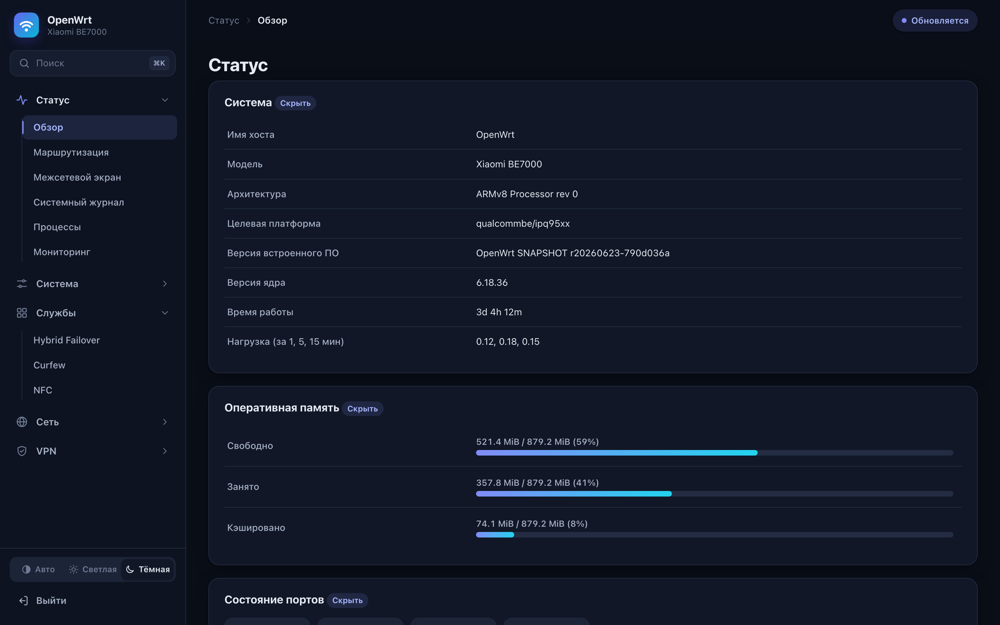

# Beam WRT

Firmware for the Xiaomi BE7000 based on OpenWrt.
 

[Русская версия](README.md) · [中文](README.zh.md) · 

Beam WRT is fresh OpenWrt from main for the Xiaomi BE7000 (RC06 board, IPQ9554 SoC), kernel 6.18, no kexec. Up to 1.3.1 the build was simply called be7000-openwrt, after the repository. The system boots straight from flash, the stock firmware stays in the other slot, and you can go back to it at any time.

**What the firmware can do, what is new in 1.4 and how it differs from others is collected on [features.en.md](docs/features.en.md).**

Since 1.4.0 it is based on OpenWrt main (commit d958caf, September 29, 2026) with the kravasuper port on top, as the patch series in patches/port. Up to 1.4.0 the build sat on the kravasuper branch xiaomi_be7000, commit 790d036a. On top of it I added fixes to the Ethernet driver, without which the system on my board never got as far as the network ([patches.en.md](docs/patches.en.md)), and a set of services that make life with two slots and the factory bootloader predictable.

The current version is **1.5.0**. Images are in [Releases](../../releases), checksums in sha256sums.txt. How to install it is in the section [Installation, updating, rollback](#installation-updating-rollback).

## Contents

- [What has been tested](#what-has-been-tested)
- [Known issues](#known-issues)
- [Installation, updating, rollback](#installation-updating-rollback)
- [What is in the image](#what-is-in-the-image)
- [Documentation](#documentation)
- [Theme](#theme)
- [License](#license)
- [Thanks](#thanks)
- [Support the project](#support-the-project)

## What has been tested

My own board is an RC06, IPQ9554 rev 1.1, stock firmware 1.1.38, 1 GB of RAM.

- The system boots in 25 seconds and gets to LuCI and SSH.
- The gigabit port gives about 940 Mbit/s in both directions with iperf3, no CRC errors and no loss.
- The 2.5 Gbit/s ports. For one owner a 2500 Mbit/s link worked, 72 GB went through the port in one direction and 30 in the other without errors. On my own board I only tested 100 and 1000.
- Wi-Fi 2.4 and 5 GHz work as Wi-Fi 6, calibration from the ART partition is picked up, the TLMM6 and TLMM7 fix for 5 GHz is applied.
- Wi-Fi 7 (EHT80) in access point mode works, tested with a laptop. macOS shows PHY Mode 802.11be, channel 36 at 80 MHz, iperf3 945 Mbit/s. Automatic channel selection on 5 GHz also works.
- With country RU the QCN9274 radio firmware itself forbids 802.11be (NO-EHT shows up in `iw reg get`), and the access point runs as Wi-Fi 6. This is a decision of the radio firmware, not the driver. Since 1.4.0 the 5 GHz mode block warns about it, and a button next to it sets US for 5 GHz only.
- The MLO mode comes up in a few seconds, the lower radio on channel 36 at 160 MHz, the upper one on 149 at 80 MHz. MLO is tested and works. A Wi-Fi 7 laptop joins such a network on one link, two links adding up on one device was not measured, there is no way to run such a test.
- PPPoE on a live line, sysupgrade keeping settings and the list of enabled services, WireGuard and AmneziaWG (the module and the awg utility are built for this kernel).

## Known issues

- **Ethernet on some boards before 1.3.0.** The ports brought up a link, but the router did not receive a single frame. The cause was the kernel's RPM request for the l2 regulator, fixed in 1.3.0, details in [patches.en.md](docs/patches.en.md#ethernet-reception-on-some-boards). If the cable still does not work on your board, write in [issue #1](https://github.com/timofey-maykov/be7000-openwrt/issues/1) or in the 4PDA thread, you can get in over Wi-Fi (network OpenWrt-BE7000, password be7000openwrt).
- In the two-radio and MLO modes each radio gets half of the antennas, so one device is slower than in one-radio mode. The mode is chosen on Network, Wireless or with be7000-5g-split mode, details in [patches.en.md](docs/patches.en.md#two-radios-on-5-ghz).
- There is about 20 MB of space for /overlay. For anything large it is better to move it to USB with the be7000-extroot command.
- The kernel uses the mainline qcom-ppe rather than the vendor NSS. Hardware NAT offload on the PPE came in 1.4.0, it is tested and works, and it is off by default. For Wi-Fi clients packets still pass the CPU once.
- The port lags behind OpenWrt main, updating the base may require reworking the patches.

## Installation, updating, rollback

Everything is described step by step in [docs/instruction](docs/instruction), the release archive contains the same files.

- [installing from stock](docs/instruction/1-install-en.txt)
- [updating](docs/instruction/2-update-en.txt), including from the System, Build update page
- [rollback to stock and what to do if something went wrong](docs/instruction/3-rollback-and-problems-en.txt)
- [firmware features](docs/instruction/4-features-en.txt), packages, 5 GHz modes and MLO, stock settings import, slots, offload, USB storage, Docker

If you update to 1.4 from any 1.x version, read the first section of the update file first.

Do not touch the bootloader (0:APPSBL and 0:APPSBL_1) under any circumstances, it is the only place where the board can be killed for good.

## What is in the image

OpenWrt main r20260929-d958caf, kernel 6.18.52, Wi-Fi drivers from backports 7.2, architecture aarch64_cortex-a73, apk packages. The feeds are pinned to the same date (feeds-pins.txt). The exact package list is in the manifest file, the build config in config.buildinfo.

Notable items in the image are the qcom-ppe module with PPE acceleration, firewall4 and nftables, PPPoE, dnsmasq-full, WireGuard and AmneziaWG, tc and ifb for shaping, the ath11k (2.4 GHz) and ath12k (5 GHz) drivers with firmware, full wpad, LuCI with https, Russian and Chinese, USB storage support, iperf3. The kmod-ath11k-ahb package was not in the port's profile, I added it. Without it the built-in 2.4 GHz radio is left without a driver.

Services that are not in regular OpenWrt live in overlay-files.

| Service | What it does |
|--------|-----------|
| be7000-bootconfirm | at the end of boot confirms the slot to the bootloader and resets the attempt counters |
| bigoverlay | on first boot moves /overlay to the stock settings partition, see [storage.en.md](docs/storage.en.md) |
| be7000-wifi-defaults | on a clean install enables both radios with the OpenWrt-BE7000 network |
| be7000-feeds | brings the kernel modules feed path in line with the hash of the kernel in ROM |
| be7000-romsync | after an image change resets the copy of the apk database in overlay and reinstalls the user's packages |
| be7000-bootlog | writes a boot log to flash (crash_syslog), see [debugging.en.md](docs/debugging.en.md) |
| 79_be7000_stale_modules | in preinit moves aside kernel modules from the previous image so they do not shadow the modules from ROM |
| be7000-stock-import | on the first boot after an install from stock takes Wi-Fi, the internet connection and the router address from there |
| be7000-5g-split | the 5 GHz modes, one radio, two radios and MLO, prepares the mode before the driver loads |
| be7000-extroot | moves /overlay to a USB disk and keeps it there across updates |
| be7000-ppe | copies the PPE bridge offload choice into the module options before the module loads |
| be7000-slots | shows what the slots hold and switches the boot, the System, Slots page |
| be7000-docker | installs Docker on a disk and sets up the firewall and DNS for the containers, commands setup, firewall, diag |
| be7000-update | checks for and installs new versions, tells you once a day about a new release |
| be7000-leds | state triggers for the LEDs, State (Beam WRT) on the LED Configuration page, and the amber Wi-Fi 2.4 GHz LED |

Packages install out of the box. The official mirror builds qualcommbe for cortex-a53, while this build targets cortex-a73, so there is no aarch64_cortex-a73 directory on the mirror and all the common feeds return 404. The image has its own feed configured, built from the same tree and signed with a key the image already trusts. After `apk update` there are more than 600 packages available, including nano, htop, tcpdump, strace, tmux, rsync, jq, modemmanager with USB modem drivers, ksmbd and ttyd. Kernel modules are in a separate feed, because on the mirror they are built for a different kernel. One more separate feed holds hybrid-failover, it rebuilds itself with every new release.

## Documentation

- [features.en.md](docs/features.en.md), what the firmware can do and how it differs from others
- [cookbook.en.md](docs/cookbook.en.md), recipes, modem, phone over USB, Docker, 5 GHz modes and MLO, settings from stock, slots, updating
- [benchmarks.en.md](docs/benchmarks.en.md), measurements and how to repeat them
- [patches.en.md](docs/patches.en.md), what was added to the port and why, patches in progress
- [bootloader.en.md](docs/bootloader.en.md), flash slots, how the bootloader picks a slot, when it brings up the network
- [storage.en.md](docs/storage.en.md), space for settings and packages, the volume shared with stock, moving to USB
- [building.en.md](docs/building.en.md), how the firmware is built in CI and how to build it yourself
- [debugging.en.md](docs/debugging.en.md), how to find the cause without UART, the boot log in flash
- [CHANGELOG.en.md](CHANGELOG.en.md), what changed from version to version

## Theme

I made my own theme for LuCI, Nimbus. It has the menu on the left, quick search across pages, light and dark schemes, and it looks fine on a phone. Sources, screenshots and installation instructions are in the [luci-theme-nimbus](luci-theme-nimbus) folder, a ready package is in the releases. The theme is not tied to the BE7000 and installs on any OpenWrt with LuCI 23.05 and newer. The theme interface is in Russian, English and Chinese.

## License

The patches in patches are distributed under GPL-2.0-only, like the Linux kernel. The scripts and text can be used however you like. The images are built from OpenWrt sources, the kravasuper port, these patches and packages from awg-feed. Versions and config are listed in config.buildinfo and feeds-pins.txt.

## Thanks

The full list with links is on the System, Credits page in LuCI, and the same list is in the SSH login greeting. Special thanks to zerc00l for remote access to the router. The cause of the dead Ethernet was found on that board, and on his new board with an ESMT flash UART showed the bug that sometimes kept such routers from booting. And to kravasuper for the port everything stands on. Thanks to everyone who helped in the GitHub issues, BurmecianKnight, KaMaToZzz, zh8416, xiaoqi2020 and tera2null.

## Support the project

The build is made in spare time. That means debugging on other people's boards, dozens of test images and CI. If it was useful to you, you can support the work. Thank you!

| Method | Details |
|------|-----------|
|  | `UQBZhwBuZCgQOtrgRGMu4PKiiOcf9dTKxRpapZt1oDn0m3yH` |
|  | `0xeb05803030afB64C903C7BfB79d18957efD6bcCd` |
|  | `GcKxgUeSfKnsPL9iEaYKJArosfYKMtE4W5wVDdHrRVTu` |
|  | `bc1qcyd3kaa3y2cv2yn90rsa628y3ptz56zs05z2jq` |
|  | `itnitro` |

